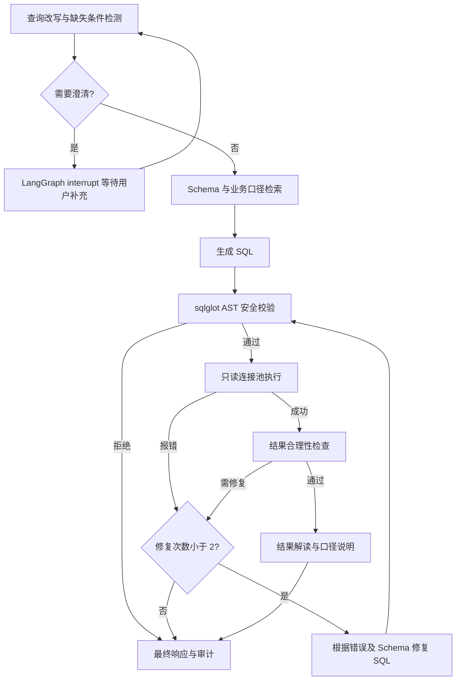

# TXT2SQL 自助取数 Agent

独立的 LangGraph 问数应用：中文提问、歧义追问、Schema 检索、SQL 生成与安全校验、只读查询、有限修复、结果解读和审计。

## 快速开始

需要 Python 3.11+。在仓库根目录执行：

```powershell
python -m venv apps/txt2sql/.venv
apps/txt2sql/.venv/Scripts/python -m pip install -r apps/txt2sql/requirements.txt
apps/txt2sql/.venv/Scripts/python apps/txt2sql/server.py
```

打开 http://127.0.0.1:8080 。默认使用合成 SQLite 数据，免密钥支持四个固定示例；配置模型后可自由提问。
Linux/macOS 使用 `apps/txt2sql/.venv/bin/python` 替代以上 Python 路径。

## 查询流程



## 目录

- `apps/txt2sql/server.py`：HTTP 服务、模型接口和只读连接池。
- `apps/txt2sql/workflow.py`：状态图、检索、安全规则、结果验证与审计。
- `apps/txt2sql/security.py`：SQL AST 校验与物理表访问白名单。
- `apps/txt2sql/knowledge.py`：Schema 自动采集、业务口径及正确 SQL 示例审核。
- `apps/txt2sql/manage_knowledge.py`：本地知识目录管理命令。
- `apps/txt2sql/knowledge/`：合成数据基准、审核操作说明和 JSON 模板。
- `apps/txt2sql/static/`：问数页面。
- `apps/txt2sql/test_*.py`：应用及状态流测试。
- `.github/workflows/txt2sql.yml`：持续集成。

完整配置、启动及能力边界见 [应用说明](apps/txt2sql/README.md)。

Schema 已支持自动采集，业务口径和 SQL 示例通过本地审核目录管理。
操作步骤与 JSON 模板见 [知识目录说明](apps/txt2sql/knowledge/README.md)。

## 数据授权与未授权请求

权限由服务端和数据库执行边界决定，用户提问、模型输出以及知识条目不能扩大访问权限。
目前服务固定连接本地演示 SQLite 文件，只允许读取 `orders`，问数接口不接受数据库地址、文件路径或授权表配置。

| 层次 | 当前实现 | 未授权请求的处理 |
| --- | --- | --- |
| Schema 采集 | 只采集服务端指定的授权表，默认 `orders` | 其他表不进入结构上下文；不抽样业务数据 |
| SQL 安全校验 | sqlglot AST 检查单条 SELECT、物理表白名单、跨库引用及高危操作 | 生成的 SQL 未通过时直接拒绝并记录审计，不进入执行或自动修复 |
| 数据库执行 | SQLite `mode=ro` 连接及授权回调，限制读取表和允许函数 | 独立阻断写入、读取其他表、ATTACH 等操作 |
| 结果及导出 | 页面导出当前已经通过查询链路返回的结果 | 失败响应不返回上一次结果，导出不会重新绕过权限查询 |

例如，`SELECT * FROM customers`、`SELECT * FROM other.orders`、`DELETE FROM orders` 都会被阻止。
“授权表”仅代表允许读取，不代表允许更新、删除或修改表结构。
业务口径审核、SQL 示例审核与数据权限审批是不同的事情；通过知识审核不会新增数据访问权限。

当前白名单分别位于 `security.py`、`server.py` 的执行器和 `knowledge.py` 的采集器中，尚未统一为配置化权限服务。
仅修改 Schema 采集参数或使用知识 CLI 的 `--database`，不会切换 Web 服务的数据源，也不会扩大执行权限。
以后新增表时，需要由管理员同步调整采集、AST 校验和数据库执行边界，并验证未授权访问测试。

### 当前权限边界

- 当前为本地单用户、表级只读限制，没有登录、角色、按用户区分的表权限或行列级权限。
- `X-App-Token` 是页面请求令牌，不是用户身份认证或角色鉴权。
- AST 安全拒绝直接终止；数据库执行阶段的授权异常目前与其他 SQLite 错误统一处理，可能进入最多两次修复，但每次仍须重新通过 AST 与数据库权限检查。尚未单独分类为不可重试的权限错误。
- 具有主机或数据库文件修改权限的人可以绕过应用访问文件；需要操作系统权限管理保护代码、配置、检查点和数据文件。

### 多人及真实数据库接入规划（尚未实现）

用户申请数据访问后，应由数据负责人审批，再由管理员配置授权，用户重新发起查询。
Agent 不得自动增加授权、替换连接凭据或改用管理员账号。

正式版本需要在服务端根据已认证身份计算数据源、表/视图、列、行、操作及导出权限，
并在真实数据库侧使用最小权限的只读账号、受控视图或数据库支持的行级策略。
检索、执行、缓存、导出和审计应遵循同一权限范围；权限拒绝应分类为不可重试错误。
自助取数保持只读，业务数据修改需另设明确授权的操作流程。

## 验证

```powershell
apps/txt2sql/.venv/Scripts/python -m unittest discover -s apps/txt2sql -p "test_*.py" -v
```

当前为本地单用户 MVP；尚未接入生产数据库、多人身份权限或向量语义检索。
真实模型请求与自然语言准确率需要配置模型后验证。
结果解读会向配置的模型发送最多前 20 行结果；本地检查点存有问题、SQL 和查询结果。
本项目尚未选定对外分发许可证；第三方依赖继续遵循各自许可证。
