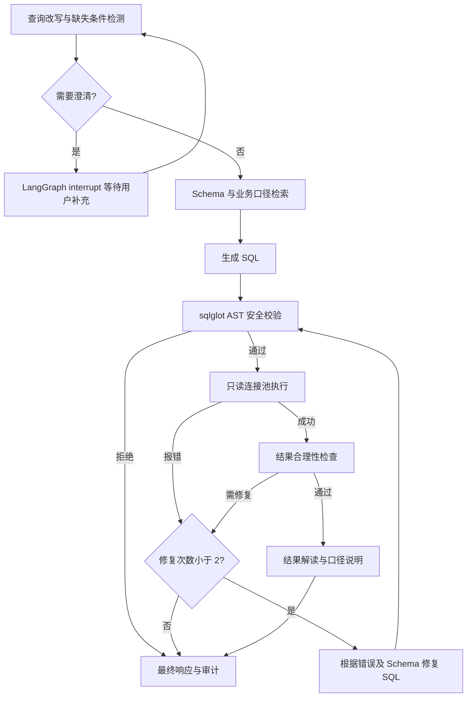

# TXT2SQL 自助取数 Agent

独立的 LangGraph 问数应用：中文提问、歧义追问、Schema 检索、SQL 生成与安全校验、只读查询、有限修复、结果解读和审计。

## 快速开始

需要 Python 3.11+。在仓库根目录执行：

```powershell
python -m venv apps/txt2sql/.venv
apps/txt2sql/.venv/Scripts/python -m pip install -r apps/txt2sql/requirements.txt
apps/txt2sql/.venv/Scripts/python apps/txt2sql/server.py
```

打开 http://127.0.0.1:8080 。默认使用合成 SQLite 数据，免密钥支持四个固定示例；配置模型后可自由提问。
Linux/macOS 使用 `apps/txt2sql/.venv/bin/python` 替代以上 Python 路径。

## 查询流程



## 目录

- `apps/txt2sql/server.py`：HTTP 服务、模型接口和只读连接池。
- `apps/txt2sql/workflow.py`：状态图、检索、安全规则、结果验证与审计。
- `apps/txt2sql/static/`：问数页面。
- `apps/txt2sql/test_*.py`：应用及状态流测试。
- `.github/workflows/txt2sql.yml`：持续集成。

完整配置、启动及能力边界见 [应用说明](apps/txt2sql/README.md)。

## 验证

```powershell
apps/txt2sql/.venv/Scripts/python -m unittest discover -s apps/txt2sql -p "test_*.py" -v
```

当前为本地单用户 MVP；尚未接入生产数据库、多人身份权限或向量语义检索。
真实模型请求与自然语言准确率需要配置模型后验证。
结果解读会向配置的模型发送最多前 20 行结果；本地检查点存有问题、SQL 和查询结果。
本项目尚未选定对外分发许可证；第三方依赖继续遵循各自许可证。
